<div align="center">


# USB Guard

**Auto-close every program launched from a USB drive the moment it is unplugged.**

A lightweight Windows tray utility built with Electron.

[English](README.md) | [简体中文](README.zh-CN.md)

</div>

---

## Why

Portable apps launched from a USB drive keep running silently after the drive is pulled out. They hold file handles, leave temp files behind, and can corrupt data. USB Guard watches your drives and force-closes every process that was started from a drive as soon as that drive disappears.

## Features

- **Drive monitoring** — cheap 300ms polling, detects removal in under half a second
- **Process tracking** — matches processes by executable path prefix (`E:\...`) and expands to child processes
- **Two-phase cleanup** — force-closes tracked processes immediately at unplug (~1s), then a fresh scan catches anything started since the last snapshot
- **Per-drive switch** — enable/disable guarding on each drive independently
- **Auto-guard** — automatically guards removable disks (USB drives) when they appear
- **Auto-launch at login** — optional startup with Windows
- **System tray** — stays resident, close-to-tray supported
- **Light / dark theme** — follow the system, or pick light/dark manually
- **Guard universe** — GLSL particle valley and guardian, morphing team portraits, data tunnel, astronaut, refractive glass shield and seven scroll chapters
- **Bilingual UI** — English / 简体中文, switchable at runtime
- **No backend, no telemetry** — all data comes from local Windows system APIs, works fully offline

## Screenshots

The UI ships in both English and 简体中文, switchable at runtime.

### English UI

| Light | Dark |
| :---: | :---: |
| 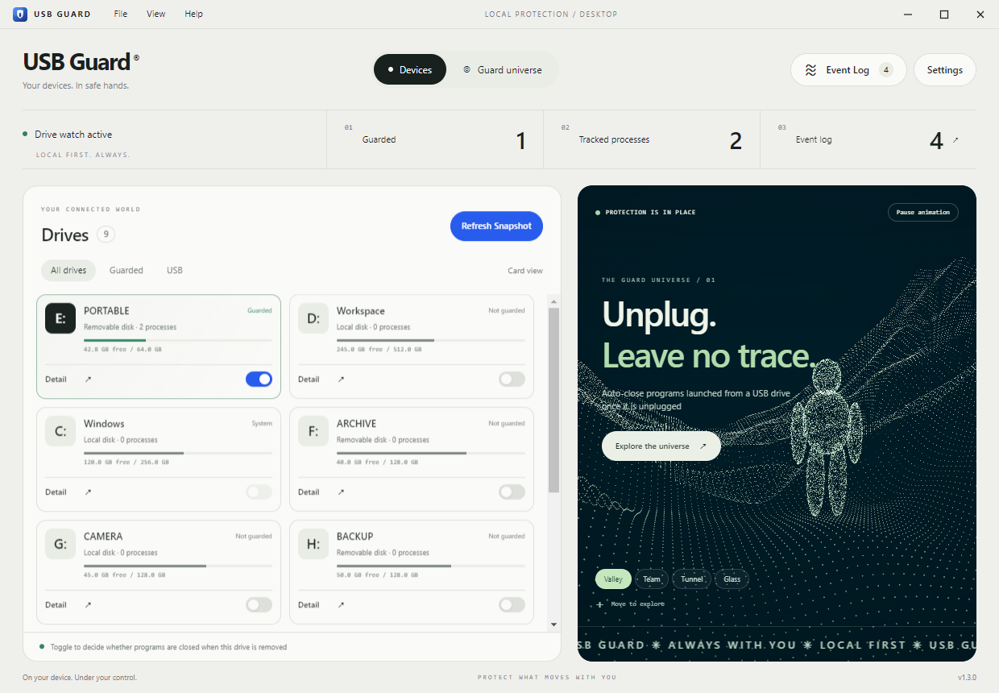 | 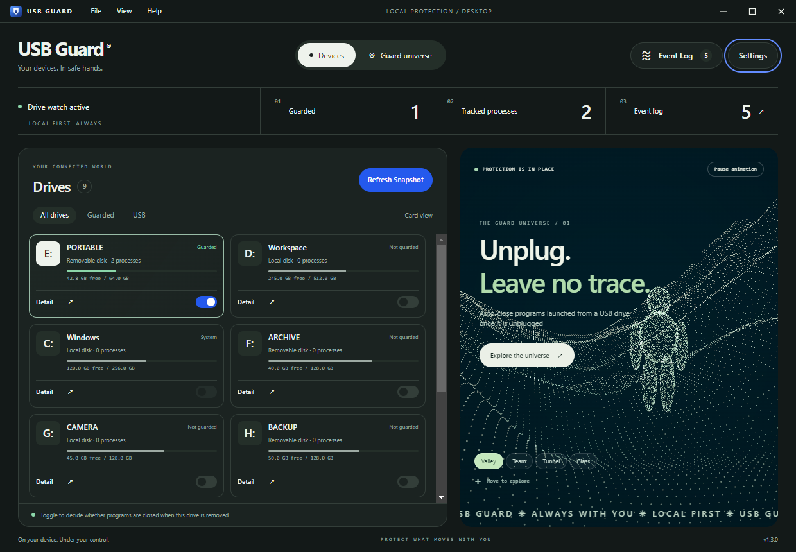 |

<p align="center">
  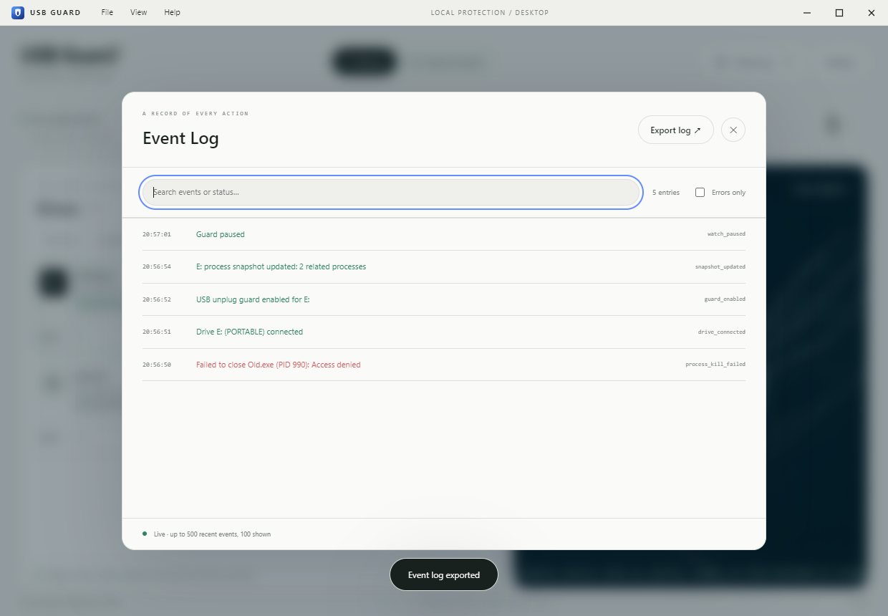
  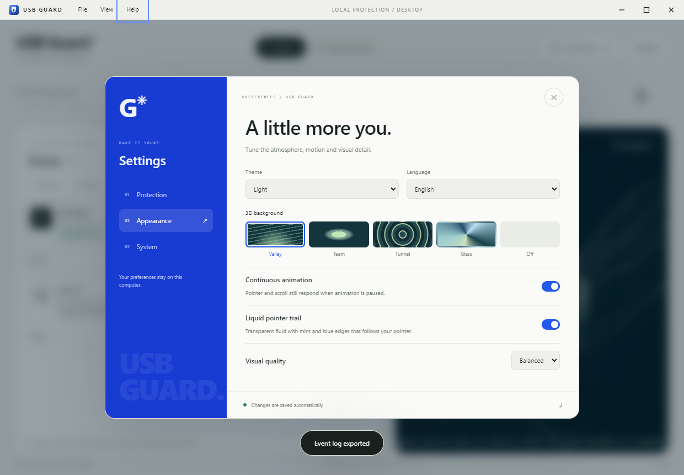
  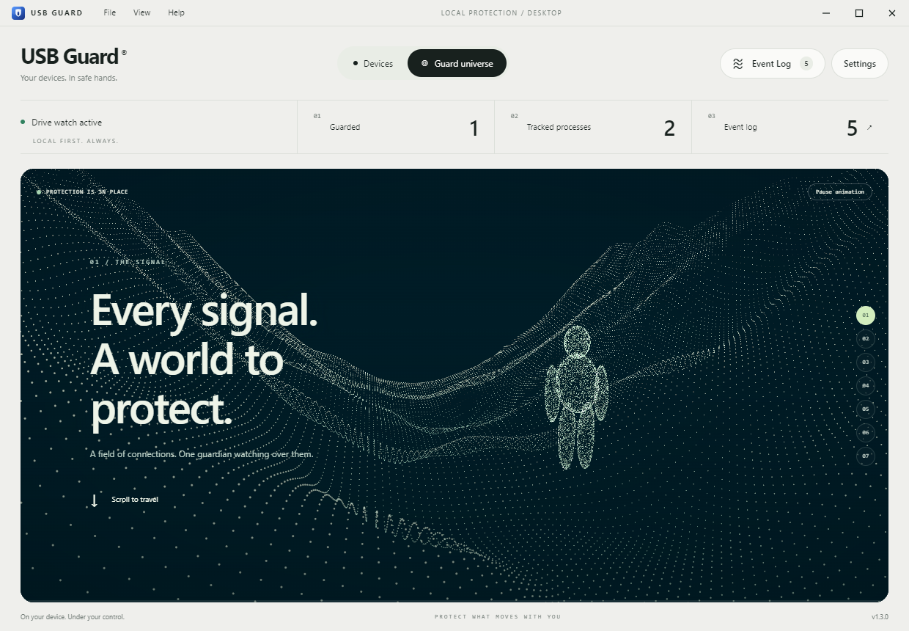
  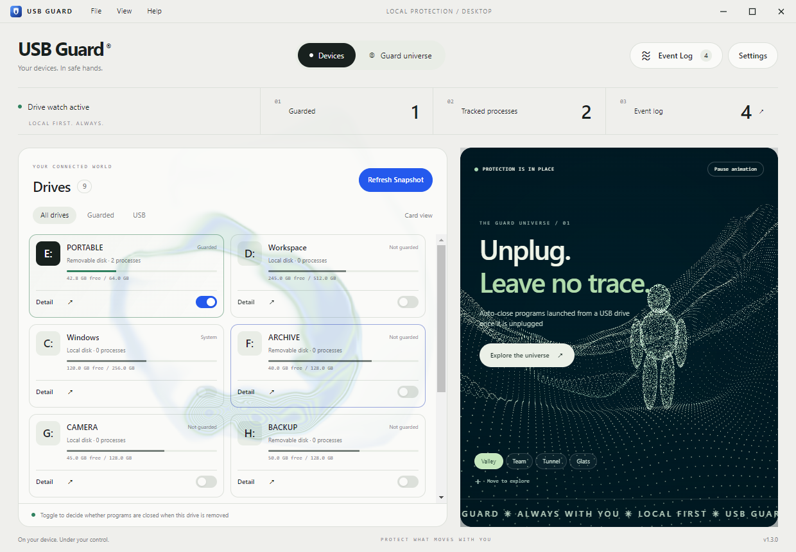
</p>

### 中文界面

| 浅色主题 | 深色主题 |
| :---: | :---: |
| 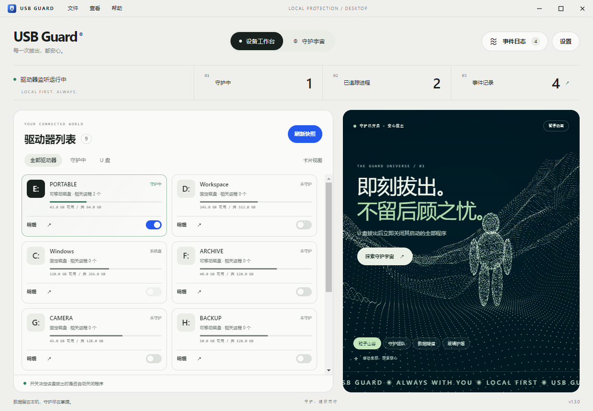 | 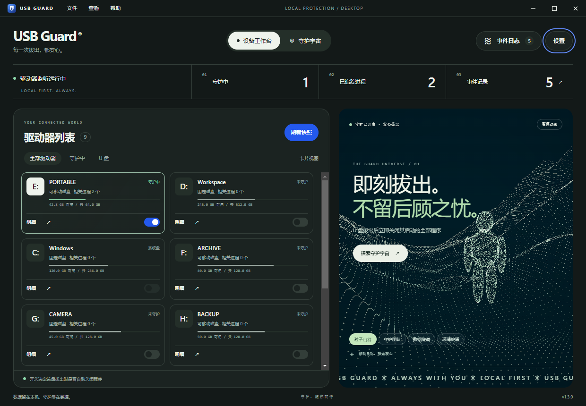 |

<p align="center">
  
  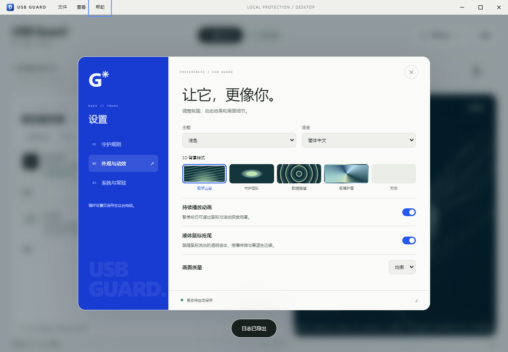
  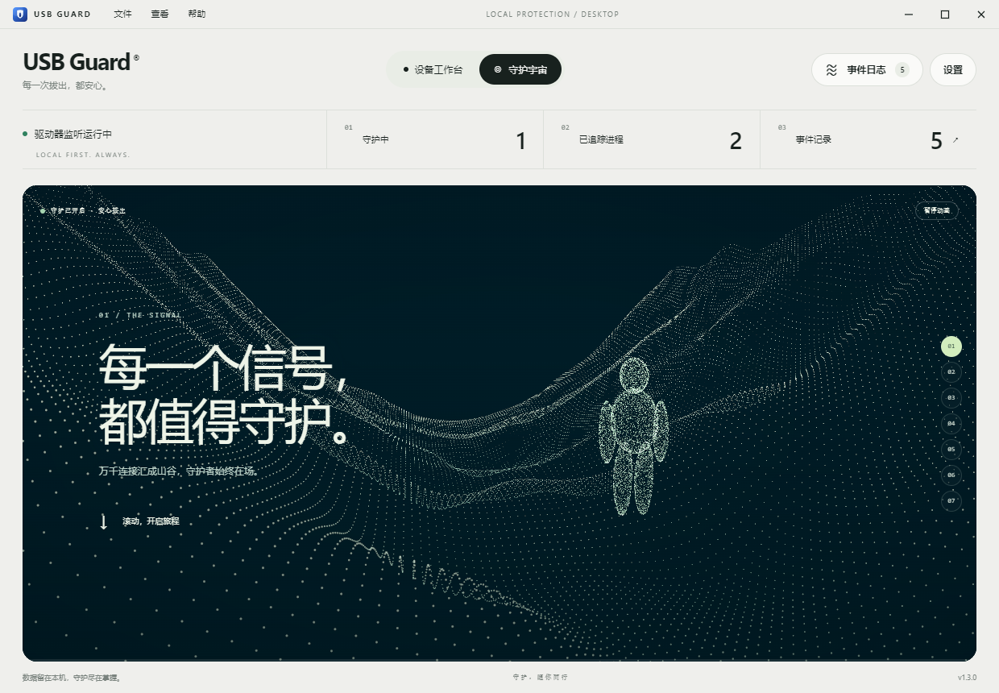
  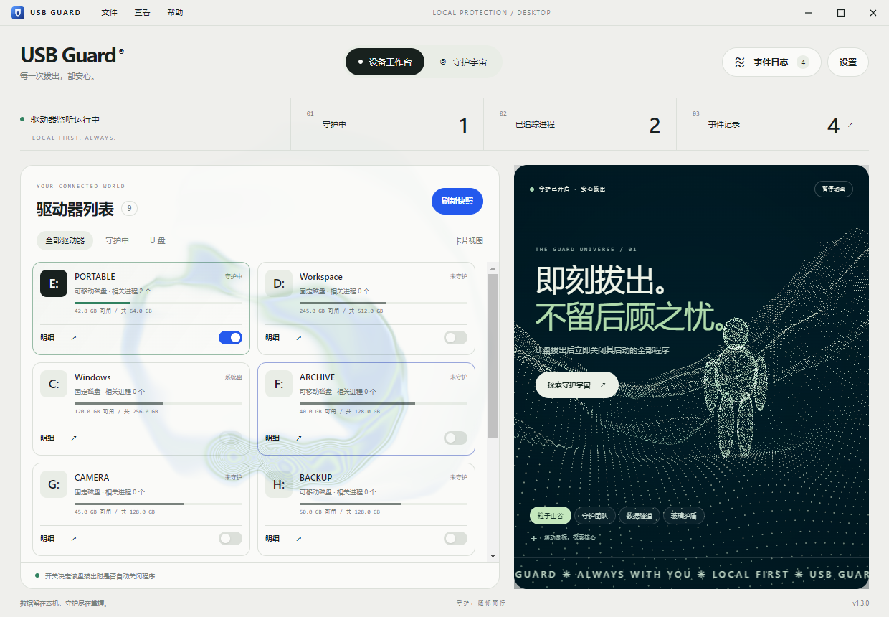
</p>

## Requirements

- Windows 10 / 11
- Node.js 18+ (development only)

## Getting Started

```bash
git clone https://github.com/FlyingTigerReally/usb-guard.git
cd usb-guard
npm install
npm start
```

## Usage

1. Launch the app — all detected drives are listed in the **Drives** panel.
2. Toggle the switch on a drive to enable unplug guarding (removable disks are auto-guarded by default).
3. While guarded, the app keeps a periodic snapshot of processes running from that drive.
4. **Unplug the drive** — every tracked process is force-closed immediately.
5. Check the **Event Log** dialog for what happened (drive removed, processes closed, failures).

The tray icon keeps the guard running in the background. Right-click it for **Show main window** / **Exit**.

## Settings

| Setting                                | Default         | Description                                                  |
| -------------------------------------- | --------------- | ------------------------------------------------------------ |
| Also force-close child processes       | On              | Close the whole process tree (`taskkill /T`)                 |
| Auto-guard removable disks             | On              | Enable guarding automatically for USB drives (driveType = 2) |
| Minimize to tray when window is closed | On              | Keep guarding in the background                              |
| Launch at login                        | On              | Register/unregister Windows auto-start                       |
| Theme                                  | Follow system   | Follow system / Light / Dark                                 |
| Scene preset                           | Particle valley | Valley / Team / Tunnel / Glass / Off                         |
| Continuous animation                   | On              | Pausable; pointer and scroll remain interactive              |
| Liquid pointer trail                   | On              | Transparent mint/blue fluid across the workspace             |
| Visual quality                         | Balanced        | Low / Balanced / High render resolution and frame budget     |
| Language                               | English         | UI language: English / 简体中文                              |

## Workspace UI

The device dashboard keeps the drive grid in the main area with independent scrolling (six full cards at the standard 1240 × 860 window). Logs open in a searchable dialog with an error filter and local JSON export. Settings have Protection, Appearance and System tabs; custom Electron menus and window controls replace the native menu.

The separate Guard universe view contains seven scroll chapters: particle valley and humanoid guardian, three morphing point-cloud portraits, data tunnel, procedural astronaut, refractive glass shield, capability cards linked to settings, and badges calculated from current guard state and event history. A looping wordmark, magnetic buttons, hover lighting and card tilt complete the interaction.

Original geometry is generated in `src/renderer/scene3d.js`; independent GLSL sources live in `src/renderer/shaders/` and load through a fixed-file IPC allowlist. The scene uses a renderer/RAF chain, a ping-pong pointer-flow texture, a scene render target and a final distortion pass. A separate transparent WebGL layer applies mint/blue liquid highlights over native controls without intercepting clicks; it only renders during pointer movement and the following 3.2-second decay. The 3D scene also samples the flow for refraction. The flow shaders are adapted from the supplied blog project; see THIRD_PARTY_NOTICES.md for attribution. Glass samples a separate background render target. Low/Balanced target 30 fps; High targets 60 fps. Pausing, hidden windows, reduced-motion preferences and WebGL fallback are supported. Scenes use local vendors and procedural assets; no reference-project models or textures are copied.

Run `npm run verify:ui` for an Electron integration check using the real window, preload and IPC with isolated fixture drives. It uses a temporary settings directory and never scans or closes real processes or changes login items. Run `npm run verify:ui:fallback` to check the fallback. Screenshots and results are saved in `verification/`. Physical drive removal still requires a real USB device to verify.

## How It Works

Drive detection uses a **two-layer scheme** to stay responsive without wasting CPU:

```
  fast layer (every 300ms, no subprocess)          full scan (PowerShell)
┌────────────────────┐    drive appears/gone     ┌───────────────────┐
│ fs.existsSync(root)│ ────────────────────────▶ │ Win32_LogicalDisk │  confirm + detail
└─────────┬──────────┘                           └───────────────────┘
          │ drive removed
          ▼
┌────────────────────┐  phase 1: kill snapshot   ┌───────────────────┐
│   Guard Service    │ ────────────────────────▶ │  taskkill /T /F   │  (~1s after unplug)
└─────────┬──────────┘                           └───────────────────┘
          │ phase 2: fresh scan → kill anything new
          ▼
┌────────────────────┐   snapshot every 5s       ┌───────────────────┐
│  kill dispatch     │ ◀──────────────────────── │  Win32_Process    │
└────────────────────┘                           └───────────────────┘
```

- **Fast layer** — a cheap `fs.existsSync` probe of each drive root every 300ms; a full PowerShell scan only runs when a drive actually appears or disappears.
- **Two-phase cleanup** — at unplug time, tracked processes from the latest snapshot are killed immediately (~1s after unplug), then an on-demand scan catches anything started since the last snapshot and kills those too.
- **Snapshot** — a process snapshot is refreshed every 5s (kept large on purpose: cleanup no longer depends on it being fresh).
- Devices where the root probe is unreliable (network / optical drives) fall back to periodic full scans only.

A process is considered "launched from the drive" when its executable path starts with the drive root (e.g. `E:\`) or its command line references the drive root. Child processes under the same root are included recursively.

## Build Installer

```bash
npm run build
```

Output goes to `dist/` as an NSIS installer.

## Project Structure

```
usb-guard/
├── assets/icons/            # SVG sources + generated PNG / .ico
├── scripts/
│   └── generate-icons.js    # SVG -> PNG / .ico generator (npm run icons)
├── src/
│   ├── main.js              # Electron main process (window / tray / menu / IPC)
│   ├── preload.js           # contextBridge API surface
│   ├── i18n/
│   │   ├── index.js         # t() resolver
│   │   └── locales/         # en.js, zh-CN.js
│   ├── services/
│   │   ├── driveWatcher.js  # drive enumeration + removal detection
│   │   ├── processGuard.js  # process scanning + taskkill
│   │   ├── guardService.js  # orchestration + event log
│   │   ├── settings.js      # settings persistence
│   │   └── ps.js            # PowerShell invocation helper
│   └── renderer/            # UI (HTML / CSS / JS + Three.js scenes)
└── package.json
```

## Notes & Limitations

- Some NTFS-formatted USB drives are reported as `Local disk` (driveType = 3) by Windows. Those need manual toggling, or extend the auto-guard rule in `guardService.js`.
- Processes running with elevated (administrator) privileges cannot be closed by a non-elevated instance. Run USB Guard as administrator for full coverage.
- A process started _before_ guarding is enabled is only captured after the next snapshot (default 5s) or the on-demand scan at unplug time.

## Configuration

Settings are stored in `%APPDATA%/usb-guard/settings.json`. All state flags use `0/1` or English enums. Key options:

```json
{
  "killChildren": 1,
  "autoGuardRemovable": 1,
  "snapshotIntervalMs": 5000,
  "removePollMs": 300,
  "autoLaunch": 1,
  "language": "en",
  "theme": "system",
  "scene3d": "core"
}
```

## Contributing

Contributions are welcome! Please open an issue first to discuss what you would like to change.

1. Fork the repository
2. Create your feature branch (`git checkout -b feature/amazing-feature`)
3. Commit your changes (`git commit -m 'Add amazing feature'`)
4. Push to the branch (`git push origin feature/amazing-feature`)
5. Open a Pull Request

## Support

If this project helps you, you can buy me a coffee via **Alipay** (支付宝):


Scan the QR code with the Alipay app. Any amount is appreciated — thank you for supporting open source!

## License

This project is licensed under the MIT License — see the [LICENSE](LICENSE) file for details.
