<div align="center">


# USB Guard

**U 盘拔出的瞬间，自动关闭从它启动的全部程序。**

基于 Electron 的轻量 Windows 托盘工具。

[English](README.md) | [简体中文](README.zh-CN.md)

</div>

---

## 为什么需要它

从 U 盘启动的便携软件，在 U 盘被拔掉后仍会在后台悄悄运行——它们持有文件句柄、遗留临时文件，甚至可能损坏数据。USB Guard 持续监听你的驱动器，一旦检测到驱动器消失，立即强制关闭从该盘启动的所有进程。

## 功能特性

- **驱动器监听** — 300ms 轻量轮询，半秒内发现拔出
- **进程追踪** — 按可执行文件路径前缀（如 `E:\...`）匹配进程，并递归纳入子进程
- **两阶段清理** — 拔出后立即关闭已登记进程（约 1 秒内动手），再扫描补杀快照间隙新启动的进程
- **按盘开关** — 每个驱动器可独立开启/关闭守护
- **自动守护** — 检测到可移动磁盘（U 盘）时自动开启守护
- **开机自启** — 可选随 Windows 登录启动
- **系统托盘** — 常驻后台，支持关窗最小化到托盘
- **浅色 / 深色主题** — 跟随系统，或手动切换
- **守护宇宙** — 独立 GLSL 粒子山谷与人物、团队点云切换、数据隧道、宇航员、折射玻璃护盾，七段滚动旅程
- **自定义标题栏** — 应用内菜单、窗口拖动、最小化 / 最大化 / 关闭到托盘
- **驱动器筛选与容量** — 全部 / 守护中 / U 盘筛选，实时显示可用容量
- **日志筛选与导出** — 仅看异常，或将完整日志导出为本地 JSON
- **中英双语** — English / 简体中文，运行时随时切换
- **无后端、无遥测** — 全部数据来自 Windows 本地系统 API，完全离线可用

## 界面截图

界面支持简体中文与 English 双语，运行时随时切换。

### 中文界面

| 浅色主题 | 深色主题 |
| :---: | :---: |
| 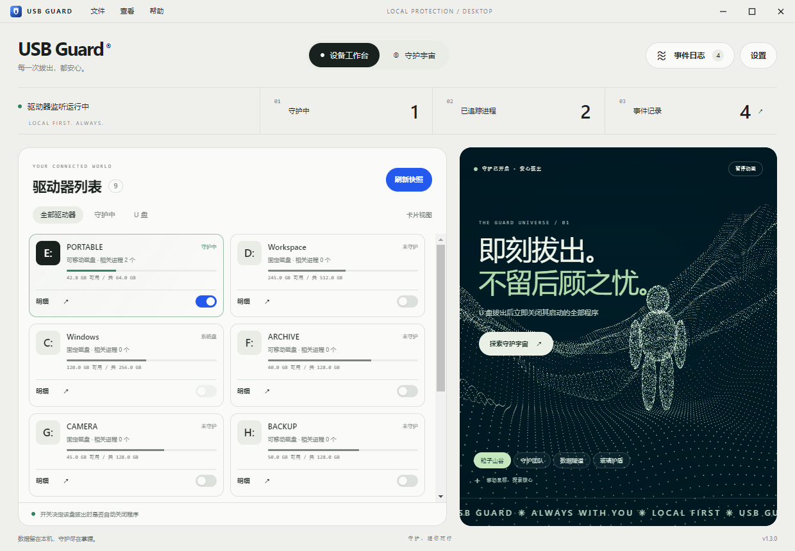 | 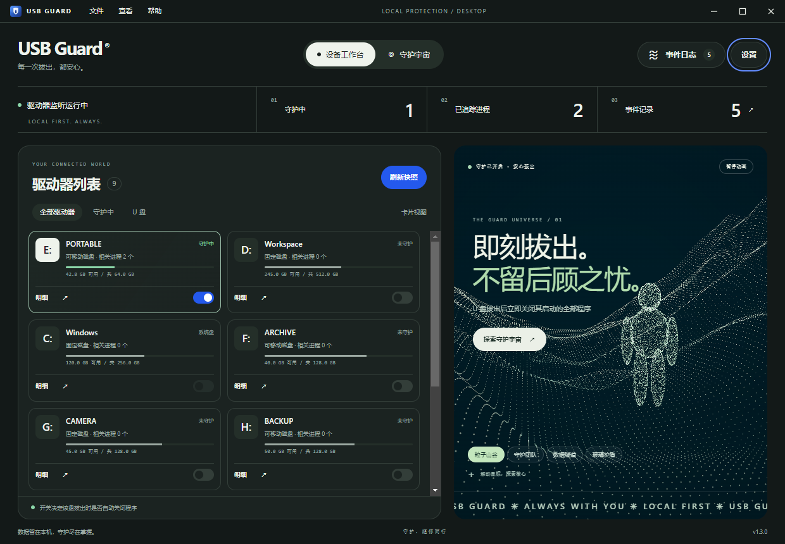 |

<p align="center">
  
  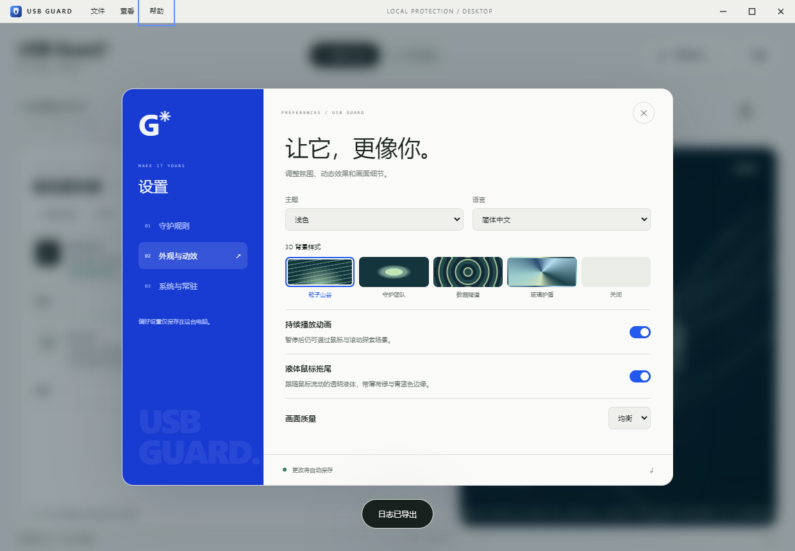
  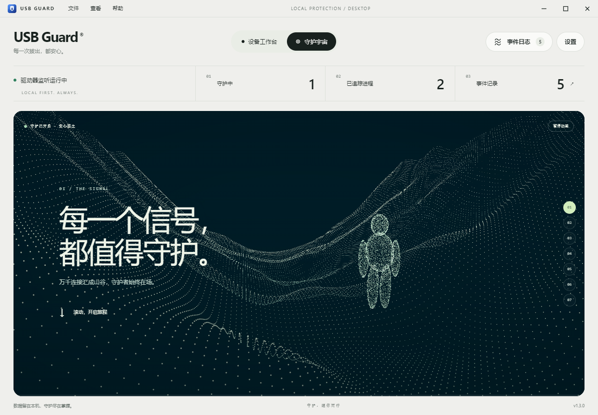
  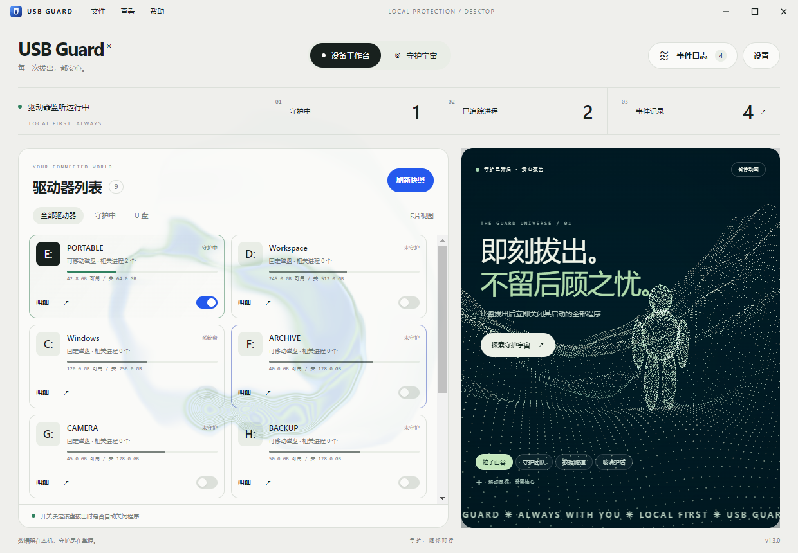
</p>

### English UI

| Light | Dark |
| :---: | :---: |
| 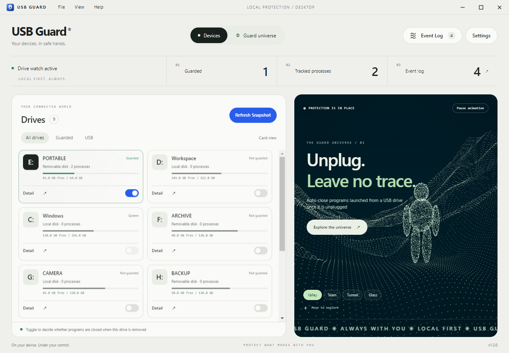 | 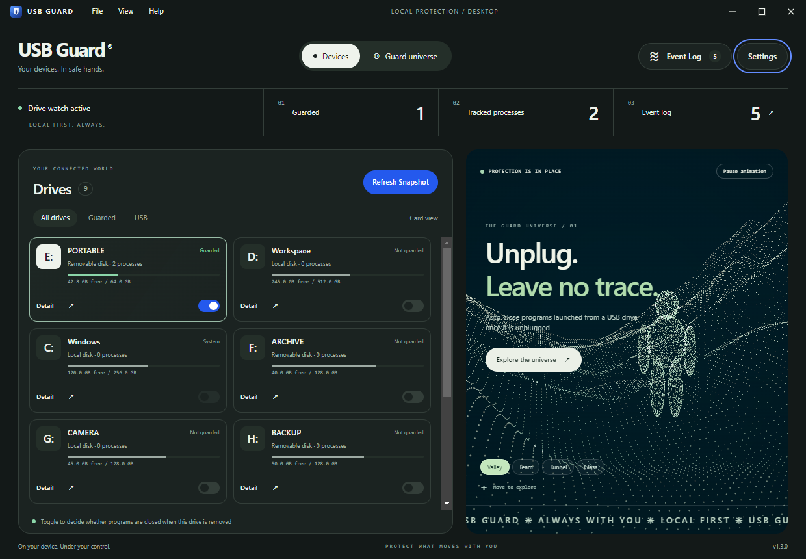 |

<p align="center">
  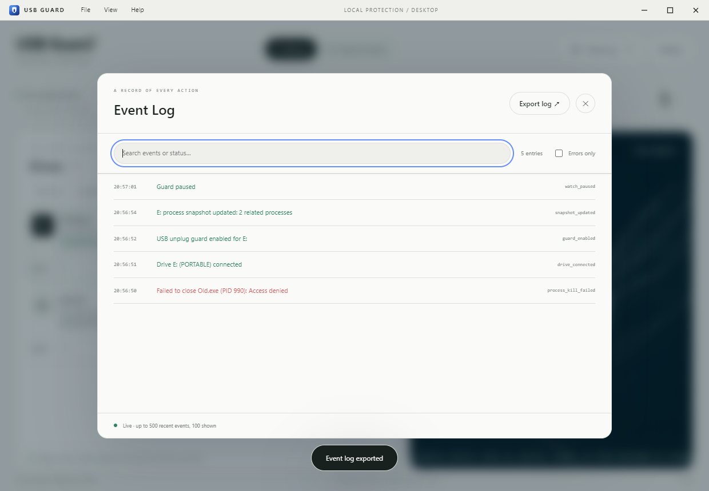
  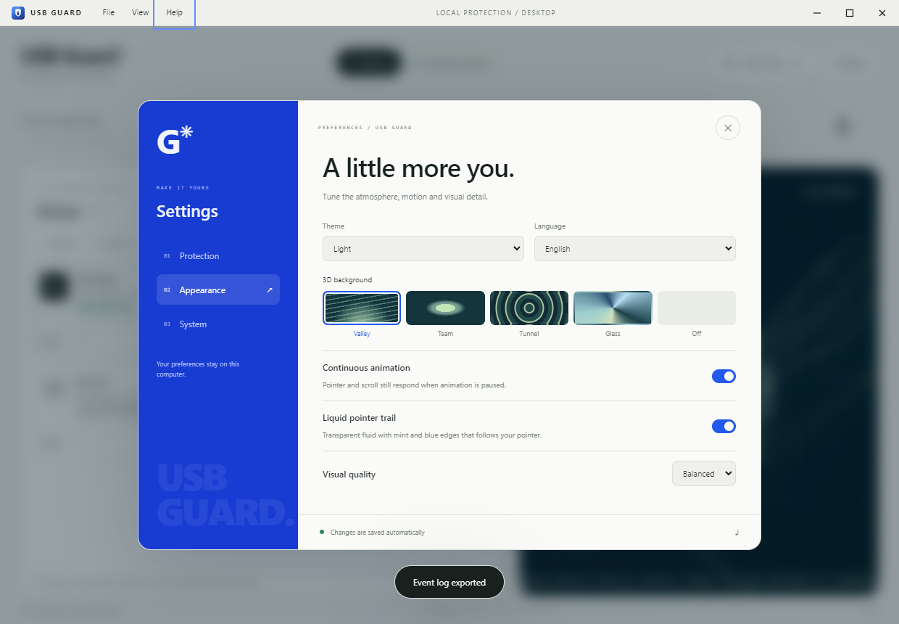
  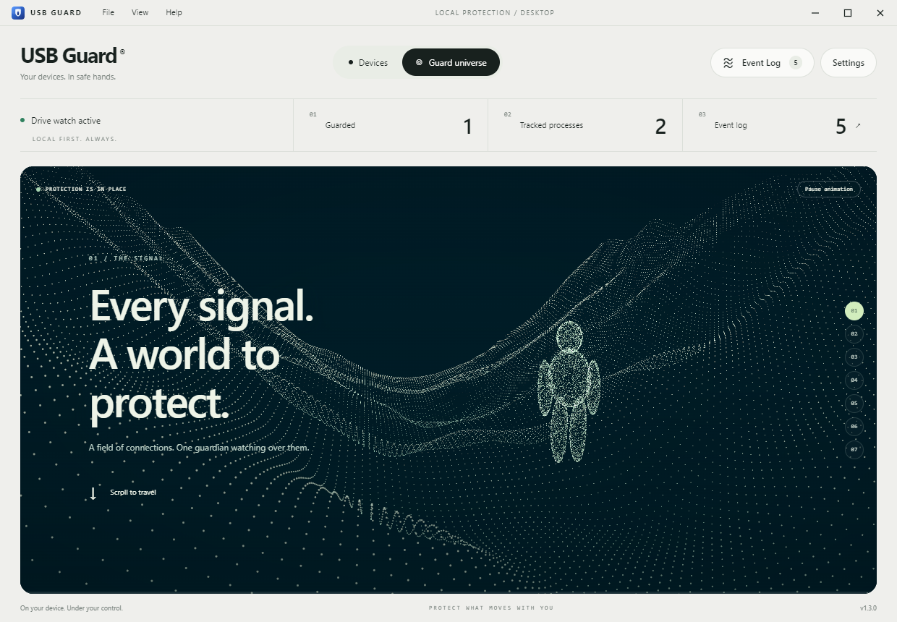
  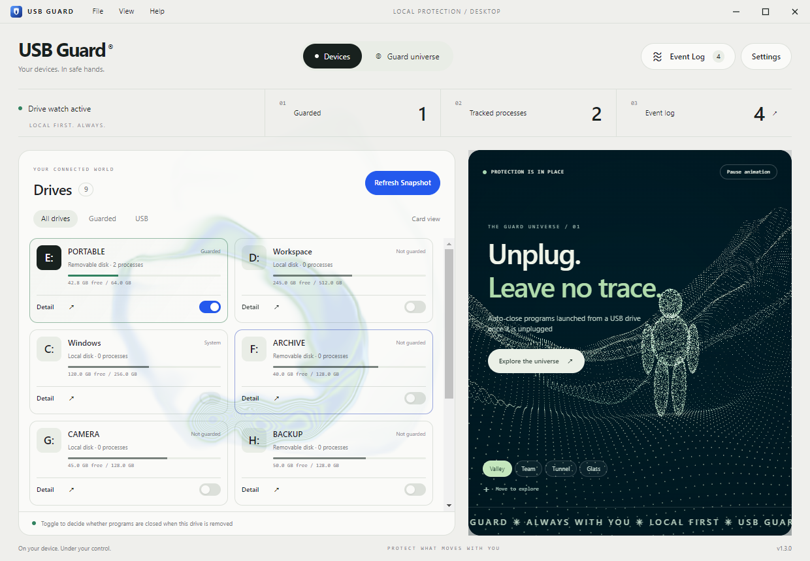
</p>

## 运行环境

- Windows 10 / 11
- Node.js 18+（仅开发阶段需要）

## 快速开始

```bash
git clone https://github.com/FlyingTigerReally/usb-guard.git
cd usb-guard
npm install
npm start
```

## 使用方法

1. 启动应用，所有检测到的驱动器会显示在 **驱动器列表** 面板。
2. 打开某个驱动器的开关即可开启拔出守护（可移动磁盘默认自动守护）。
3. 守护期间，应用会周期性记录从该盘启动的进程快照。
4. **拔掉 U 盘** — 所有已登记进程立即被强制关闭。
5. 在 **事件日志** 面板查看处理结果（拔出、关闭进程、失败原因）。

托盘图标让守护在后台持续运行。右键可选 **显示主界面** / **退出**。

## 设置项

| 设置项                         | 默认值   | 说明                             |
| ------------------------------ | -------- | -------------------------------- |
| 连同子进程一起关闭             | 开       | 关闭整棵进程树（`taskkill /T`）  |
| 检测到可移动磁盘时自动开启守护 | 开       | U 盘（driveType = 2）自动守护    |
| 关闭窗口时最小化到托盘         | 开       | 后台持续守护                     |
| 开机自动启动                   | 开       | 注册/注销 Windows 自启动         |
| 主题                           | 跟随系统 | 跟随系统 / 浅色 / 深色           |
| 场景预设                       | 粒子山谷 | 山谷 / 团队 / 隧道 / 玻璃 / 关闭 |
| 持续播放动画                   | 开启     | 可暂停，保留鼠标与滚动交互       |
| 液体鼠标拖尾                   | 开启     | 全工作区的薄荷绿 / 青蓝透明液体  |
| 画面质量                       | 均衡     | 节能 / 均衡 / 精细               |
| 语言                           | 简体中文 | 界面语言：English / 简体中文     |

## 工作台与守护宇宙

设备工作台以驱动器网格为主区，标准 1240 × 860 窗口可完整展示六张卡片，其余驱动器在列表内部滚动。事件日志移入独立弹窗，支持搜索、仅看异常和 JSON 导出；设置分为「守护规则 / 外观与动效 / 系统与常驻」。窗口使用自定义 Electron 标题栏、菜单与窗口控制。

「守护宇宙」提供七段滚动场景：粒子山谷与点云人物、三种角色的点云头像切换、数据隧道、程序化宇航员、折射玻璃护盾、可跳转设置的能力卡片、依据真实状态与事件记录生成的守护徽章。配合品牌文字循环、鼠标流场、深度视差、按钮磁吸与卡片倾斜交互。

原创几何由 `src/renderer/scene3d.js` 生成，独立着色器存放于 `src/renderer/shaders/`，通过固定文件白名单 IPC 加载。3D 场景包含独立渲染链、鼠标流场双缓冲纹理、场景离屏渲染与最终折射通道；玻璃从独立背景纹理采样折射。另有透明 WebGL 层，在原生界面上叠加薄荷绿与青蓝色的液体边缘，不拦截按钮点击；只在鼠标移动及之后 3.2 秒的消退期间渲染。3D 内容会依据同一流场进行实际折射。流场着色器移植自用户提供的 blog 项目，来源见 THIRD_PARTY_NOTICES.md。节能 / 均衡模式以 30 fps 为目标，精细模式以 60 fps 为目标；支持暂停、关闭场景、隐藏窗口停帧、减少动态效果偏好和 WebGL 降级。资源全部来自本地依赖与原创程序化几何，没有复制参考项目的模型或贴图。

## 界面验证

执行 `npm run verify:ui`，会启动真实 Electron 窗口，通过实际 preload / IPC 检查筛选、守护开关、进程抽屉、日志导出、语言、主题、场景与窗口控制。驱动器数据由隔离的模拟服务提供，配置写入临时目录，不修改开机启动项，也不扫描或关闭系统进程。

执行 `npm run verify:ui:fallback` 可验证没有 WebGL 时的界面降级。截图和检查结果写入 `verification/`（不纳入 Git）。实际拔盘与进程关闭仍需使用真实 U 盘进行验证。

## 工作原理

驱动器检测采用**双层探测**，兼顾响应速度与 CPU 开销：

```
  快速层（每 300ms，不创建子进程）                完整扫描（PowerShell）
┌────────────────────┐   盘符出现/消失时触发    ┌───────────────────┐
│ fs.existsSync(root)│ ───────────────────────▶ │ Win32_LogicalDisk │  确认 + 取详情
└─────────┬──────────┘                          └───────────────────┘
          │ drive_removed（拔出事件）
          ▼
┌────────────────────┐  第一阶段：快照立即关杀  ┌───────────────────┐
│   守护编排服务      │ ───────────────────────▶ │  taskkill /T /F   │  （拔出后 ~1s）
└─────────┬──────────┘                          └───────────────────┘
          │ 第二阶段：按需扫描补杀新进程
          ▼
┌────────────────────┐   每 5s 刷新一次快照     ┌───────────────────┐
│     关杀调度        │ ◀─────────────────────── │  Win32_Process    │
└────────────────────┘                          └───────────────────┘
```

- **快速层** — 每 300ms 用一次轻量 `fs.existsSync` 探测各盘根目录（无子进程开销）；只有盘符真正出现/消失时才触发一次 PowerShell 完整扫描确认。
- **两阶段清理** — 拔出时先用最近一次快照立即关杀（约 1 秒内动手），随后按需扫描补杀快照间隙新启动的进程。
- **快照** — 进程快照每 5 秒刷新一次（有意放宽：清理已不依赖快照的新鲜度）。
- 根目录探测不可靠的设备（网络盘 / 光驱）自动转为仅靠周期性完整扫描处理。

进程判定规则：可执行文件路径以盘符根目录开头（如 `E:\`），或命令行引用了该盘根目录，即视为「从该盘启动」。同根目录下的子进程会被递归纳入。

## 打包安装程序

```bash
npm run build
```

产物输出到 `dist/`，生成 NSIS 安装包。

## 项目结构

```
usb-guard/
├── assets/icons/            # SVG 原稿 + 生成的 PNG / .ico
├── scripts/
│   └── generate-icons.js    # SVG → PNG / .ico 生成器（npm run icons）
├── src/
│   ├── main.js              # Electron 主进程（窗口 / 托盘 / 菜单 / IPC）
│   ├── preload.js           # contextBridge API 暴露层
│   ├── i18n/
│   │   ├── index.js         # t() 翻译解析器
│   │   └── locales/         # en.js, zh-CN.js
│   ├── services/
│   │   ├── driveWatcher.js  # 驱动器枚举 + 拔出检测
│   │   ├── processGuard.js  # 进程扫描 + taskkill
│   │   ├── guardService.js  # 编排 + 事件日志
│   │   ├── settings.js      # 设置持久化
│   │   └── ps.js            # PowerShell 调用封装
│   └── renderer/            # 界面（HTML / CSS / JS + Three.js 场景）
└── package.json
```

## 注意事项与限制

- 部分 NTFS 格式化的 U 盘会被 Windows 识别为「固定磁盘」（driveType = 3），此类需手动开启守护，或扩展 `guardService.js` 里的自动守护规则。
- 以管理员权限运行的进程无法被普通权限的实例关闭。如需完整覆盖，请以管理员身份运行 USB Guard。
- 在守护开启**之前**启动的进程，要等下一次快照（默认 5 秒）或拔出时的按需扫描才会被登记。

## 配置文件

设置存储在 `%APPDATA%/usb-guard/settings.json`。所有状态字段使用 `0/1` 或英文枚举。主要配置项：

```json
{
  "killChildren": 1,
  "autoGuardRemovable": 1,
  "snapshotIntervalMs": 5000,
  "removePollMs": 300,
  "autoLaunch": 1,
  "language": "zh-CN",
  "theme": "system",
  "scene3d": "core"
}
```

## 参与贡献

欢迎贡献代码！请先开 Issue 讨论你想做的改动。

1. Fork 本仓库
2. 创建功能分支（`git checkout -b feature/amazing-feature`）
3. 提交改动（`git commit -m 'Add amazing feature'`）
4. 推送分支（`git push origin feature/amazing-feature`）
5. 发起 Pull Request

## 支持一下

如果这个项目对你有帮助，欢迎请作者喝杯咖啡 ☕（**支付宝**扫码即可）：


打开支付宝「扫一扫」扫码赞助，金额随意，感谢你对开源的支持！

## 开源协议

本项目基于 MIT 协议开源，详见 [LICENSE](LICENSE) 文件。
